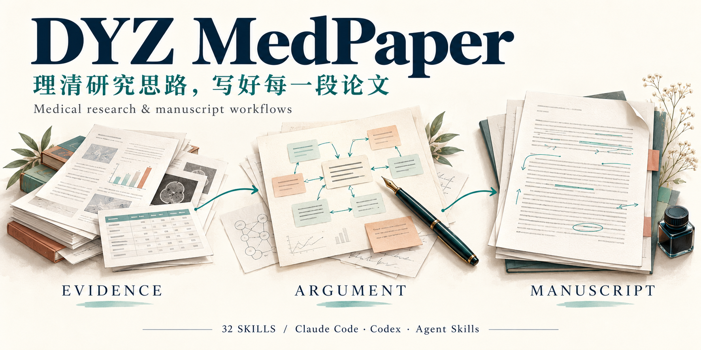
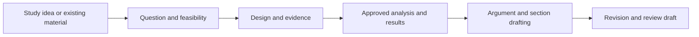

<!-- README_SYNC: source=working-tree; updated=2026-11-02 -->

[简体中文](README.md) · English

# DYZ MedPaper



**An AI manuscript workflow for clinicians and medical researchers: turn the data, results and drafts you already have into a clear argument, then work through writing and revision.**

Built on Agent Skills for **Claude Code, Codex and other agents that support the standard**. [Choose your setup](#agents)

⭐ [Star this workflow](https://github.com/duyunzhoudyz/dyz-med-paper-skills) to keep it handy for your next paper.

[](https://github.com/duyunzhoudyz/dyz-med-paper-skills)
[](#status)
[](#skills)
[](https://www.python.org/downloads/)
[](LICENSE)

[Teaching examples](#examples) · [Quick start](#quick-start) · [Workflow](#workflow) · [Skill map](#skills)

## Start with the task holding up your paper

You have results tables but no clear argument. You have read the literature, yet the discussion still repeats the results. Or a major revision has arrived, and you need to decide what to change first. DYZ MedPaper organizes these jobs into connected tasks: assess the material, plan the argument, draft sections, check evidence, and prepare revisions and deliverables.

Install the skills in your chosen agent and describe the task. The 32 skills supply instructions, templates and selected local tools; the assistant selects the relevant steps from your request and available material. Chinese requests are the primary interaction path.

| What you have | Example request | Deliverable for this step |
|---|---|---|
| A data dictionary and study idea | Assess which questions these data can answer and what is missing. Do not run statistics. | Data adequacy assessment, gaps and a feasible route |
| Verified results and literature | Clarify the paper's main argument, then plan the questions each discussion paragraph should answer. | Core claim, supporting evidence and paragraph plan |
| Results tables and a discussion draft | Rewrite the discussion from these materials, explain the structure, and list unsupported points separately. | Discussion draft, revision rationale and open questions |
| An existing manuscript | Identify the most consequential problems, locate them in the text, and prioritize revisions. | Manuscript diagnosis and revision priorities |
| A manuscript and reviewer comments | Map each comment to manuscript changes and a response. Separate completed work from pending work. | Point-by-point response table, locations and task status |

Enter at the stage your existing material supports. Translation, abstracts and local edits can also be handled individually. See the [task cards](docs/task-cards.md) for inputs and deliverables.

## Build the argument into the manuscript

**Establish what the paper answers.** The writing plan brings the research question, existing evidence, study contribution and core claim into one argument map, then assigns them to sections. The discussion returns to the question raised in the introduction.

**Give each paragraph a purpose.** Section guidance covers topic sentences, comparisons with the literature, interpretation, limitations and reverse outlining. For revisions, request the original wording, revision and rationale to see why the structure or expression changed. See the [writing guidance and synthetic examples](dyz-med-writing-plan/references/writing-craft.md).

**Check the text alongside its sources.** Literature imports retain provenance, manuscript tools check registered claims against the current text, and translation tools compare numbers and citations. These mechanical checks detect certain discrepancies; researchers still assess whether the evidence supports the claim.

**Leave a record for the next session.** Project state can record confirmed facts, manuscript versions, open questions and revision history. Sections, response tables and basic Word review drafts can be saved in the paper project. The assistant can read those records when work resumes.

<a id="examples"></a>

## See the deliverables

These are **synthetic teaching examples** stored in the repository. They illustrate methods and output structure, not actual user cases, published studies or model-quality evaluation results.

| Example | What it shows |
|---|---|
| [From cohort results to an argument map](dyz-med-writing-plan/examples/示例-他汀类药物队列论证地图构建.md) | Connecting the research question, key finding, literature gap and discussion paragraphs |
| [Diagnosing a rejected manuscript](dyz-med-manuscript-diagnose/examples/worked-example-rejected-manuscript.md) | Locating issues, setting priorities and choosing the next step |
| [Translating a results paragraph](dyz-med-translate/examples/worked-example-cn2en.md) | Source text, protected content, English translation and separate editorial notes |
| [Responding to reviewers](dyz-med-revision/examples/worked-example-reviewer-response.md) | Linking comments to response strategies, manuscript locations and revision records |

A runnable [synthetic delivery demo](scripts/run_delivery_demo.py) connects literature import, manuscript binding checks, number and citation comparison, and basic DOCX export. It also introduces a numerical change to check whether the tool detects it. It does not call a model or demonstrate writing quality. Commands are in [Validation](#validation).

<a id="quick-start"></a>

## Quick start

<a id="agents"></a>

### Choose your agent

Skills use the [Agent Skills](https://agentskills.io/specification) directory format built around `SKILL.md`. The core workflow and local scripts travel with the complete skill directory; discovery, tool permissions and invocation are provided by the host.

| Host | Personal skill directory | Project skill directory | Explicit invocation |
|---|---|---|---|
| [Claude Code](https://code.claude.com/docs/en/skills) | `~/.claude/skills/` | `.claude/skills/` | `/dyz-med-orchestrator` |
| [Codex](https://developers.openai.com/codex/skills) | `~/.agents/skills/` | `.agents/skills/` | `$dyz-med-orchestrator` |
| Other Agent Skills-compatible agents | Follow the host's documentation | Follow the host's documentation | Use the host's skill-loading or invocation mechanism |

Local installation options follow. Other agents must be able to read complete skill directories and provide the tools needed for scripts, literature search and file processing. Format compatibility does not establish verified runtime behavior on every host; see [Status](#status) for the evaluation scope.

### 1. Prepare your environment and material

- A working **Agent Skills** host, such as Claude Code or Codex, with any required account setup completed.
- **Python 3.10+** for installation and local checks. The installer uses only the standard library.
- A separate paper project folder with synthetic material or de-identified research material you are authorized to process.

**Data handling:** Local scripts do not make the whole AI session offline. Model services may receive content supplied in the conversation. Follow your institution's requirements; do not submit identifiable patient information, hospital credentials or unauthorized material.

On Windows, check `python --version`. If your Python command is `py -3`, substitute it for `python` below; macOS/Linux commonly use `python3`. Install Python from its [official website](https://www.python.org/downloads/) if needed.

### 2. Download and install

Choose **Code → Download ZIP** on the [repository page](https://github.com/duyunzhoudyz/dyz-med-paper-skills), extract it and open a terminal in that directory. Alternatively, use Git:

```bash
git clone https://github.com/duyunzhoudyz/dyz-med-paper-skills.git
cd dyz-med-paper-skills
```

**Claude Code:**

```bash
python scripts/install_codex.py --target "~/.claude/skills"
python scripts/install_codex.py --target "~/.claude/skills" --check
```

**Codex:**

```bash
python scripts/install_codex.py
python scripts/install_codex.py --check
```

The installer retains the filename `install_codex.py`. It defaults to `~/.agents/skills/` and accepts `--target` for Claude Code or another host's skill directory. Both options copy all 32 skills and their license files. Successful checks display `PASS`, the skill count and installation path. The installer does not access the network, install models or R/Python packages, or change host settings, accounts or other skills. It stops if an existing skill with the same name has different contents.

For other agents, point `--target` to the documented skill directory, or copy complete skill folders using the [manual installation instructions](#maintenance).

<details>
<summary>Install for a single paper project</summary>

Replace the path with an existing paper project directory. For Claude Code:

```bash
python scripts/install_codex.py --target "/path/to/my-paper/.claude/skills"
python scripts/install_codex.py --target "/path/to/my-paper/.claude/skills" --check
```

For Codex:

```bash
python scripts/install_codex.py --project "/path/to/my-paper"
python scripts/install_codex.py --project "/path/to/my-paper" --check
```

`--project` always installs into the project's `.agents/skills/`; use `--target` as above for Claude Code projects. Open the project in your chosen agent. Within each host, choose either a user-level or project-level installation to avoid duplicate skill names. Keep quotes around Windows paths containing spaces.

</details>

### 3. Open the paper project and describe the task

For example, after adding verified results and literature to the project:

> Use the results and literature in this folder to organize the paper's core claim and discussion paragraph plan. Identify the results and sources for each paragraph, list material gaps separately, and explain the structure.

The intended first deliverable is **an argument plan you can review**. If essential material is missing, begin with a usable outline and a gap list. Once the direction is agreed, request the relevant manuscript section.

If you are unsure where to begin, ask:

> Use dyz-med-orchestrator to read the existing paper materials, identify the current stage, and suggest the next step.

For explicit invocation, use `/dyz-med-orchestrator` in Claude Code or `$dyz-med-orchestrator` in Codex; follow other agents' invocation mechanisms. See [Maintenance and troubleshooting](#maintenance) for skill discovery. File checks establish installation consistency; actual skill loading and task selection must still be verified in your host.

<a id="workflow"></a>

## How the workflow connects



This is an optional sequence. Existing results can lead straight into writing; existing manuscripts can enter diagnosis or revision. The navigator identifies the stage and recommends a next step, while your agent selects skills for specific tasks. The workflow does not automatically execute every stage in one run.

| Study type | Sequence and handoff priorities |
|---|---|
| Observational study | Protocol and dictionary → data adequacy → approved analysis → results and writing → applicable reporting guidance → review draft; figures and text use the same results version |
| Randomized trial | Protocol, registration and approved analysis plan → actual conduct records and results → registered-outcome comparison → writing and reporting checks → review draft |
| Systematic review | Search protocol → import and deduplication → independent screening → extraction and bias assessment → approved synthesis → writing and reporting checks → review draft |

Within a fully authorized task, the assistant may continue through necessary supporting steps. Statistical execution and plan changes require approval of the specific plan; external submission requires explicit authorization and final confirmation. A request for the next step receives a recommendation. The assistant maintains project state and tool input manifests, so users do not need to write JSON, YAML or hashes.

See the [executable workflow](docs/executable-workflow.md) for literature, manuscript checks, translation and export handoffs.

<a id="skills"></a>

## 32 skills, selected by task

All directories start with `dyz-med-`. Each centers on `SKILL.md`, with templates, references, examples and scripts where needed. `agents/openai.yaml` supplies additional Codex interface and invocation metadata; other hosts use their own discovery and invocation mechanisms.

| Stage | Skill directory suffixes |
|---|---|
| Starting point and state | `ideate`, `init`, `manuscript-diagnose`, `orchestrator`, `passport` |
| Study design and evidence | `mechanism`, `data-adequacy`, `registration`, `cnki`, `key-literature`, `screening-pipeline`, `evidence-audit` |
| Analysis and presentation | `analyze`, `interpret`, `sensitivity`, `figures-tables`, `flowchart` |
| Argument and writing | `writing-plan`, `introduction`, `methods`, `results`, `discussion`, `abstract`, `write` |
| Revision and delivery | `translate`, `deai`, `guideline`, `review`, `revision`, `journal-finder`, `export`, `submit` |

`passport` maintains internal project state and usually needs no direct invocation. `cnki` is the directory name for Chinese and English literature search; it includes no CNKI account or full-text access rights.

<a id="status"></a>

## Status and dependencies

**Public beta for Claude Code, Codex and other Agent Skills-compatible agents.** The repository provides skill instructions, templates, local scripts and offline regression checks. Installation checks verify copying and byte consistency, not actual loading or invocation in any host. Host-specific natural-language routing accuracy, sustained multi-turn use, blinded writing review and medical quality have not completed independent acceptance review. Unexecuted checks remain `not_run`.

| Task | Requirements and current scope |
|---|---|
| Text explanation, writing and translation | A working agent, model and clear source material; skill instructions and most supporting documents are primarily in Chinese |
| Formal statistical analysis | An approved plan, R or the project's chosen statistical engine, and its packages; skill installation does not install these environments |
| Literature and journal checks | Network access, search tools and lawful access permissions; the bundled online search script covers PubMed only and cannot alone fulfill a multi-database systematic-review search |
| Literature import and local checks | Python's standard library supports RIS, literal-value BibTeX, NBIB and PubMed XML imports, manuscript binding checks, and number/citation comparison |
| File reading and Word delivery | Excel/Word/PDF reading needs suitable parsers; the standard-library exporter produces basic DOCX review drafts. Complex layouts, equations and native tracked changes need other tools; visual inspection requires local Word or LibreOffice |
| YAML validation and the full developer suite | PyYAML; JSON contract scripts use only the standard library |

Local checks cover only their implemented scope. For example, number comparison may detect additions and removals but cannot detect values swapped between groups or changes in claim strength. Consistent manuscript bindings do not establish evidentiary support. Researchers and relevant specialists must review the outputs; the tools do not replace statistical, ethics or medical judgment, or guarantee publication.

<a id="maintenance"></a>

## Maintenance and troubleshooting

<details>
<summary>Skills do not appear after installation</summary>

Run `--check` with the same `--target` or `--project` arguments used for installation, verify the path, then reopen the host. In Claude Code, enter `/dyz-med-orchestrator`; in Codex, use `/skills`, `$` or `$dyz-med-orchestrator`. Use other agents' skill-management interfaces as documented. Ask which `SKILL.md` was actually read in the current turn: mentioning a skill name alone does not establish loading. See the [Claude Code skills documentation](https://code.claude.com/docs/en/skills) and [Codex skills documentation](https://developers.openai.com/codex/skills).

The environment probe included in `--check` only detects Codex, Rscript and PyYAML. It does not probe Claude Code or other hosts, or validate accounts, network connectivity, package versions or document-tool functionality.

</details>

<details>
<summary>Upgrade, manual installation and removal</summary>

Run the installer from the new source checkout. Identical content is skipped. If files differ, first review any changes you made to installed copies, then specify a new backup directory outside both the source and installation directories:

```bash
python scripts/install_codex.py --upgrade --backup "/path/to/new-backup"
python scripts/install_codex.py --check
```

The example above uses Codex's default directory. For Claude Code or another custom location, keep the original `--target` in both upgrade and check commands; for a Codex project installation, keep the same `--project`. The backup contains replaced files and an installation manifest. Extra files are preserved and cause the upgrade to stop. Follow the backup manifest when restoring; files added by the new version are not automatically removed.

For manual installation, copy all 32 complete `dyz-med-*` directories into the [appropriate host directory](#agents): `.claude/skills/` for Claude Code, `.agents/skills/` for Codex, or the directory specified by another host. Include the repository's `LICENSE`, `NOTICE` and `COMMERCIAL-LICENSE.md` in every skill directory. Copy templates and scripts too, rather than only `SKILL.md`; do not install the repository's outer directory as a single skill.

Before removal, back up your edits, then remove only this project's 32 skill directories. Paper materials live separately in the paper project. Legacy `med-*` directories are not removed automatically; review any reported by the checker.

</details>

<details>
<summary>Where tools and paper materials belong</summary>

The assistant locates `scripts/`, `templates/` and `references/` relative to the loaded `SKILL.md`. Manuscript inputs and outputs belong in the paper project, not the global skill directory. Replace illustrative paths in individual instructions with actual paths.

</details>

<a id="validation"></a>

## Development and validation

Run the synthetic toolchain demo without a model account. The output must be a new directory under `tests/results/`:

```bash
python -B scripts/run_delivery_demo.py --output tests/results/my-delivery-demo
python -B scripts/sync_shared_resources.py
```

The demo produces literature records, check reports and a DOCX marked for internal review, and checks one injected numerical change. It makes no network or model calls and runs no statistical analysis. Word visual inspection and semantic review are separate. The second command only checks shared-resource synchronization.

The full offline suite requires PyYAML. If needed, install the developer dependency and run:

```bash
python -m pip install -r requirements-dev.txt
python -B scripts/run_offline_regression.py
```

The suite covers skill declarations, artifact handoffs, installation checks, local delivery tools and three synthetic study workflows. Reports go to a new `tests/results/` subdirectory. Installation checks use temporary directories; existing workspace copies receive read-only checks. See the [offline regression guide](tests/offline-regression.md) and [CI workflow](.github/workflows/check.yml).

<details>
<summary>Model evaluation and writing-quality evidence</summary>

Offline success does not establish actual skill invocation, medical correctness or submission readiness. Record real-host and medical acceptance results under the [model evaluation protocol](tests/evaluation-protocol.md); evaluate writing separately using the [blinded review protocol](tests/writing-blind-review.md).

Prepare frozen source and evaluation inputs:

```bash
python -B scripts/prepare_evaluation.py --output tests/results/my-evaluation
python -B scripts/check_eval_results.py tests/results/my-evaluation/results.json --check-current-source
```

The preparation script creates 60 inputs and an initial 30-case sequence. It does not run a model or fill in passing results. Tested sessions receive only the current prompt and matching skill sources, not scoring criteria, audit reports or test files from the frozen snapshot. Keep results `blocked` / `not_run` until host, actual model, skill set and human review are verified. Check historical records against the matching old source; do not rewrite old snapshots.

Public source excludes local installed copies, internal audits, raw execution logs, authentication material and paper data.

</details>

## License and contact

This project is **source-available** under the [PolyForm Noncommercial License 1.0.0](LICENSE). Its original text governs permitted purposes and conditions. Uses outside those grants require a [separate written commercial agreement](COMMERCIAL-LICENSE.md) in advance. The project does not claim OSI open-source status; third-party material remains subject to its own terms.

Report problems through [Issues](https://github.com/duyunzhoudyz/dyz-med-paper-skills/issues), including your operating system, agent name and version, reproduction steps and sanitized errors. Do not upload patient information or credentials.

If these methods and examples help your work, [Star the repository](https://github.com/duyunzhoudyz/dyz-med-paper-skills) as a reference for your next manuscript.
